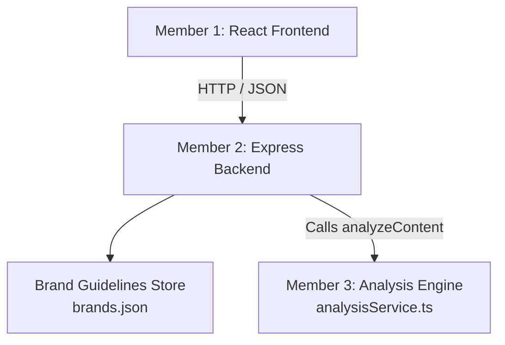

# BrandGuard AI — Integration & Architecture Guide

## 1. Overview

BrandGuard AI is an intelligent brand governance system that inspects marketing copy, press releases, and customer communications for adherence to brand guidelines, tone, terminology, and legal compliance.

## 2. Component Architecture

## 3. Integration Plan

### 3.1 When Member 1 Delivers the Frontend

1. Place the frontend code in `frontend/`.
2. Configure frontend environment `VITE_API_BASE_URL=http://localhost:5000/api`.
3. Verify CORS in `backend/.env` contains the frontend port (default: 5173 or 3000).
4. Verify endpoints:
   - Frontend loads brands via `GET /api/brands`
   - Frontend selects brand guidelines via `GET /api/brands/:brandId`
   - Frontend sends content to `POST /api/analyze` and displays issues, categories, severities, and suggested corrected copy.

### 3.2 When Member 3 Delivers the Analysis Engine

1. Member 3's engine exports:
   `analyzeContent(content: string, brand: BrandProfile): Promise<AnalysisResponse>`
2. Replace or wrap Member 3's engine inside `backend/src/services/analysisService.ts`.
3. Re-run `npm test` in `backend/` to verify all contract assertions pass without regressions.

### 3.3 Combined Run

1. Run backend: `cd backend && npm run dev`
2. Run frontend: `cd frontend && npm run dev`
3. Open web browser to test full workflow from content entry to corrected output.
