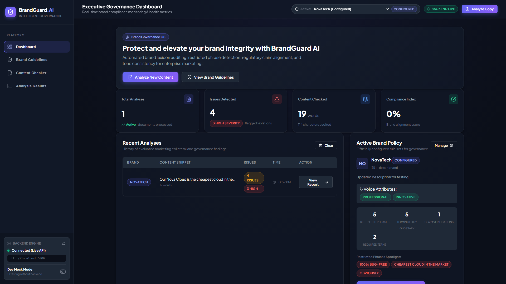
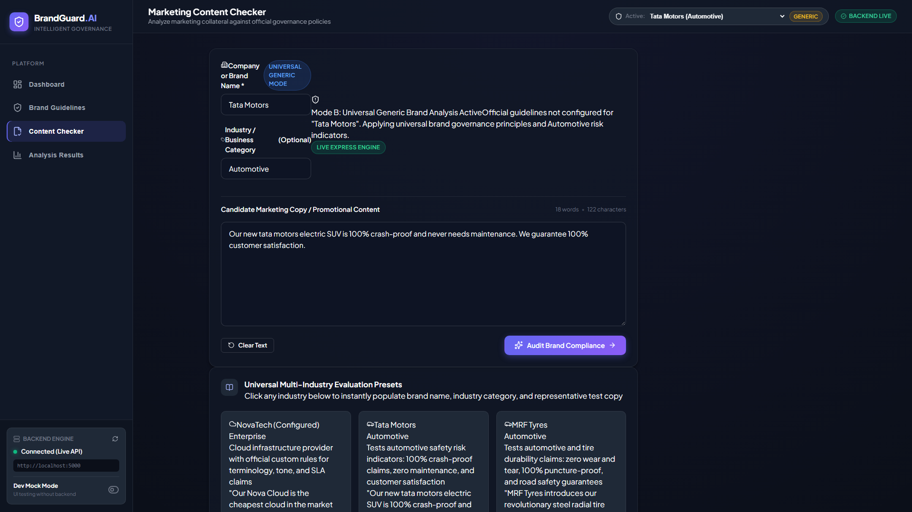
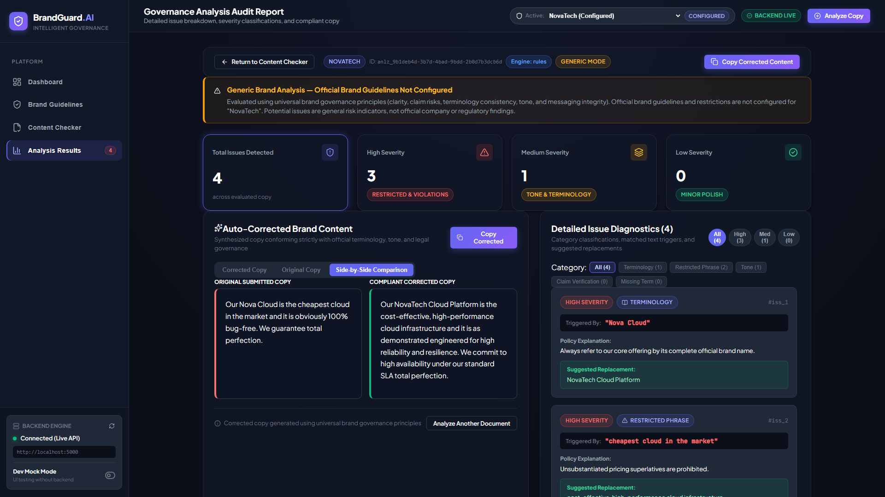
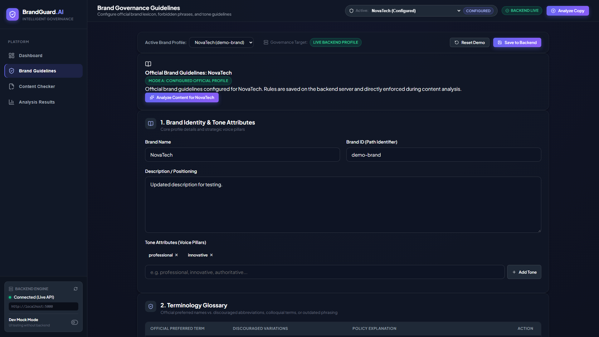

# BrandGuard AI — Intelligent Universal Multi-Industry Brand Governance Platform

[](https://www.typescriptlang.org/)
[](https://react.dev/)
[](https://nodejs.org/)
[](https://expressjs.com/)
[](https://vitejs.dev/)
[](https://vitest.dev/)
[](LICENSE)

> 🏆 **Hackathon:** TechCircuit Hackathon  
> 🏢 **Problem Statement Provider:** Inkloom AI  
> 👥 **Team Name:** ChipSmiths  
> 👨‍💻 **Team Members:** **Syeed Hussain S H** • **U Tamilarasu** • **Shyam G R** • **Sandep S**  
> 🌐 **Public Website URL:** [https://brandguard-ai-w20n.onrender.com/](https://brandguard-ai-w20n.onrender.com/)  
> *(The application can be run locally or launched with a live public tunnel via `RUN_PRODUCTION.bat`)*

---

## 1. Executive Summary

**BrandGuard AI** is an enterprise-grade brand governance and marketing compliance platform designed to audit, safeguard, and align promotional copy in real time across any commercial industry.

The platform protects corporate reputation by enforcing trademark lexicon, detecting cross-brand contamination (e.g., promotional copy praising a competitor or foreign brand), intercepting prohibited superlatives, flagging unverified liability guarantees, and generating non-hallucinatory, legally compliant marketing copy.

With **Round 3 completion**, BrandGuard AI introduces **Context-Aware Industry Mismatch Detection**, **Evidence-Based Claim Verification against Certified Brand Facts**, and a full **Human-in-the-Loop Review and Approval Workflow** backed by persistent audit logs and executive metrics.

---

## 2. Problem Statement & Solution

### The Problem

- **Cross-Brand Contamination:** High-velocity marketing campaigns and generative AI copy often introduce competitor brand names, mismatched product ecosystem terminology, or foreign trademarks into official copy.
- **Regulatory and Legal Liability:** Statements containing unverified superlatives (*"cheapest in the world"*, *"100% bug-free"*, *"never needs maintenance"*) violate truth-in-advertising standards and expose companies to litigation and regulatory fines.
- **Inconsistent Voice and Tone:** Disparate global teams often produce off-brand, colloquial, or condescending messaging that undermines premium brand equity.
- **Unconfigured Brand Gap:** Traditional brand management tools only support predefined enterprises with rigid static profiles, failing startups, agencies, and dynamic multi-brand portfolios.

### The Solution

BrandGuard AI addresses these challenges through a unified governance pipeline:

1. **Entity-Aware Brand Mismatch Checking:** Detects when marketing collateral references a different company or competitor from a curated registry of enterprise entities.
2. **Dual Governance Architecture:**
   - **Mode A (Configured Brand Profile):** Audits against saved official corporate guidelines (lexicon glossary, tone pillars, restricted phrases, SLA claim requirements).
   - **Mode B (Universal Multi-Industry Governance):** Applies universal advertising governance principles and industry-specific risk indicators for unconfigured brands or custom startups without requiring source code modifications.
3. **Non-Hallucinatory Auto-Correction:** Rewrites problematic copy by replacing detected violations with approved alternatives without fabricating specifications, pricing, warranties, or claims.

---

## 3. Core Features

- 🛡️ **Company Identity & Brand Mismatch Engine:** Real-time entity recognition cross-checks copy against selected brand identities to prevent cross-brand contamination.
- ⚡ **Dual Analysis Modes:**
  - *Mode A:* Enforces strict registered guidelines configured for known enterprises (e.g., NovaTech).
  - *Mode B:* Analyzes arbitrary custom companies using universal governance and industry-tailored risk indicators (Automotive, Consumer Electronics, Food & Beverage, Fashion, IT Services, Aerospace, Finance).
- 📋 **13-Point Comprehensive Rule Suite:**
  1. Brand and company name entity mismatch
  2. Product naming and terminology consistency
  3. Industry relevance and context
  4. Tone and brand voice consistency
  5. Unsupported superlatives and absolute claims
  6. Potentially misleading or unverified marketing assertions
  7. Conflicting statements and internal inconsistencies
  8. Excessive capitalization and aggressive punctuation
  9. Grammar, spelling, clarity, and readability
  10. Inclusive and professional communication
  11. Configured brand-specific restrictions
  12. Industry-specific risk indicators
  13. Mandatory disclosures and required context terms
- ✏️ **Compliant Content Synthesizer:** Deterministic replacement engine preserves the user's intended narrative while ensuring policy compliance.
- 📊 **Executive Governance Dashboard:** Real-time visibility into overall brand compliance scores, high/medium/low severity distributions, and audit history.
- 🔄 **Universal Company & Industry Selector:** Predefined industry presets (NovaTech, Tata Motors, MRF Tyres, Samsung, McDonald's, Nike, Infosys) plus dynamic support for custom startups.
- 📑 **Formal API Contract:** Full compatibility with the formal `API_CONTRACT.md` specification.

---

## 4. Round 3 Enhancements & Production Innovations

Round 3 expands BrandGuard AI from automated policy detection into an end-to-end enterprise governance and verification lifecycle platform.

### 4.1 Improvement 1: Context-Aware Brand Analysis and Better Corrections

#### Context Mismatch Problem & State Leakage

In modern brand compliance, generic keyword search produces false positives and awkward corrections. For example, if a restaurant brand states *"provides good bikes and delivery services"*, standard entity linters either miss the mismatch entirely or corrupt legitimate logistics descriptions. Furthermore, when switching between brands (e.g. from KFC to Tata Motors or Samsung), legacy systems suffered from state leakage, where stale results from a previous brand were erroneously displayed under the newly selected brand.

#### Contextual Implementation & Race-Condition Invalidation

1. **Contextual Industry & Offering Evaluation (`contextualMismatchChecker.ts`):**
   - Implements multi-sector contextual checking (Food & Dining, Automotive, Technology, Clothing/Fashion, General).
   - Intelligently differentiates between **commercial product offerings** and **legitimate operational context**. For instance, it flags when a food company claims to manufacture or sell motorbikes (`vehicleOfferingRegex`), while permitting delivery operations (*"delivers meals using bicycles"* via `legitimateDeliveryRegex`).
   - Dynamically resolves brand sectors from explicit user selection or the curated enterprise registry.
2. **Context-Aware Non-Hallucinatory Corrections (`contentCorrector.ts`):**
   - Rather than inserting robotic placeholders, the engine dynamically adjusts suggestions and corrections to match the selected company's official offering and industry tone.
   - For competitor brand mentions (e.g., mentioning McDonald's when auditing for KFC), it replaces competitor references with the active brand's authentic offering (*"fried chicken and sides"*) without fabricating false technical claims, warranties, or pricing.
3. **Dynamic State Management & Race Condition Invalidation (`AppContext.tsx`):**
   - Assigns a unique `auditId` to every analysis dispatch.
   - Immediately purges stale results (`setLatestAnalysis(null)`) upon company switching (`setUniversalCompany`) or starting a new audit.
   - Discards asynchronous responses returning from superseded or cancelled requests.
   - The results screen validates that `latestAnalysis.companyName` matches `activeCompanyName`, rendering a clean prompt if a company change occurred.
   - Automatically re-runs analysis with fresh findings whenever input content is updated.

---

### 4.2 Improvement 2: Evidence-Based Claim Verification

#### Unverified Claims & Absolute Guarantees Problem

Marketing collateral is frequently burdened with high-risk assertions: unverified availability guarantees (*"99.99% availability under Enterprise SLA"*), efficiency claims (*"cuts overhead by 40%"*), or impossible absolutes (*"100% bug-free"*, *"zero risk"*). Advertising standards authorities and legal teams require verifiable evidence before such assertions can be published.

#### Evidence Verification Engine Implementation

BrandGuard AI implements a 3-tier deterministic claim verification engine (`claimsChecker.ts`):

1. **Supported Claims (`supported`):**
   - Claims verified against certified brand facts configured in the brand profile (`approvedFacts` string array).
   - The engine uses token overlap analysis (>= 60% significant keyword match) and numerical/metric consistency verification (`findSubstantiatingFact`) to match claims against approved evidence.
   - Verified claims are highlighted with a green checkmark badge and citation:  
     `✓ Supported by Approved Brand Fact: "<fact>"`
2. **Unsupported Absolute Claims (`unsupported`):**
   - High-severity violations for claims that cannot be legally or technically substantiated (*"100% bug-free operation"*, *"zero risk guarantee"*, *"cheapest in the world"*, *"completely immune to cyberattacks"*).
   - Flagged with mandatory correction rules that replace absolute claims with defensible, responsible phrasing (*"engineered for high reliability and resilience"*).
3. **Claims Requiring Human Review (`requires_review`):**
   - Quantitative benchmarks (*"boosts efficiency by 30%"*) or service availability metrics (*"99.99% availability under Enterprise SLA"*) that lack an attached approved fact in the brand profile.
   - Flagged with a medium-severity callout advising marketing leads to attach verified empirical benchmarks or SLA terms before publication.

#### Grounded Verification Architecture

The system relies strictly on **configured brand facts and deterministic matching algorithms**. It does **not** rely on fabricated external search engines, opaque scrapers, or simulated live internet lookups. All approved facts are manageable through the Brand Guidelines interface and persisted via `PUT /api/brands/:brandId`.

---

### 4.3 Improvement 3: Brand Guidelines and Review/Approval Workflow

#### Accountability & Review Governance Gap

Automated compliance checks are insufficient without an accountable governance workflow. Enterprise teams require human oversight to approve compliant copy, reject non-compliant collateral with mandatory reasons, maintain an immutable audit trail, and persist decisions across page reloads.

#### Human Review & Guidelines Implementation

1. **Approve Copy & Reject Copy Actions (`AnalysisResultsPage.tsx`):**
   - Directly integrated alongside the side-by-side original and corrected copy preview.
   - Displays real-time decision status badges: `Pending Review` (Amber), `Approved` (Green), or `Rejected` (Rose).
2. **Structured Review Modal & Mandatory Justifications:**
   - **Reviewer Identity:** Captures `reviewerName` (mandatory for finalized decisions), `reviewerRole` (e.g. *Marketing Review Lead*), and optional `reviewerEmail`.
   - **Rejection Reason:** When rejecting content, a specific rejection reason is strictly required by both client-side validation and the backend controller.
   - **Approval Notes:** Optional reviewer sign-off notes for audit clarity.
3. **Page Refresh Persistence & Storage Subsystem (`reviewService.ts` & `reviews.json`):**
   - All review decisions are persisted via `POST /api/reviews` to backend storage (`Brand Guard AI-Backend/backend/src/data/reviews.json`).
   - When the user refreshes the page (`F5`) or navigates between tabs, `loadReviewForAnalysis` rehydrates the saved decision from the backend API, ensuring zero data loss.
4. **Audit Trail & Timestamps:**
   - Every review record maintains an `auditTrail` timeline logging status transitions (`pending` -> `approved` / `rejected`), reviewer identities, and timestamps.
5. **Dashboard Review Governance Metrics (`DashboardPage.tsx`):**
   - Four dedicated governance stat cards: **Approved Copy**, **Rejected Copy**, **Pending Reviews**, and **Approval Rate (%)**.
   - A full **Review & Approval Audit Trail** table rendering recent decisions, analysis IDs, brand names, reviewer roles, decision timestamps, and rejection justifications.
6. **Brand Guidelines Approved Facts Management (`BrandGuidelinesPage.tsx`):**
   - Added **Section 6: Approved Brand Facts & Evidence** enabling brand managers to view, add, and remove verified brand facts and SLA claims that feed the claim verification engine.

---

## 5. Existing Issue & Verified Bug Fix

### Problem Background: Stale Audits & Race Conditions

During multi-brand testing, switching between brands (e.g., analyzing content for KFC, then switching to Tata Motors or Samsung) occasionally resulted in:

1. **Stale Results Display:** Analysis results from the previous brand persisting on the results page under the newly selected company.
2. **Asynchronous Race Conditions:** If two audits were triggered consecutively, a slower network response from an earlier audit could overwrite the results of the newer audit.
3. **Content Change Stagnation:** Modifying marketing copy for the same brand sometimes retained previous diagnostic cards.
4. **Unhandled Empty/Failed Audits:** Submitting empty content or handling server disconnections led to ambiguous states.

### Architectural Resolution & Test Verification

The issue was comprehensively resolved through coordinated frontend and backend architectural safeguards:

1. **Brand-Specific Analysis Enforcement:** The engine validates the active brand name and sector, ensuring that brand identity mismatch rules, competitor rules, and tone rules strictly correspond to the selected entity.
2. **Immediate Invalidation on Brand Switch:** In `AppContext.tsx`, calling `setUniversalCompany` resets `latestAnalysis` to `null` if the target company differs from the current analysis brand.
3. **Request Token Tracking (`activeAuditId`):** Every audit request generates a unique UUID. Slower asynchronous responses returning with outdated IDs are dropped immediately.
4. **Empty Input & Error Guard:** Both frontend forms and the backend controller enforce strict content validation (`content.trim().length >= 1`), returning `400 Bad Request` with an explicit error message instead of corrupting state.
5. **Verified with 7 Automated Integration Tests:** Validated in `Brand Guard AI-Backend/backend/tests/verifyStaleAuditScenarios.test.ts`:
   - *Scenario 1:* KFC audit correctly detects competitor (McDonald's).
   - *Scenario 2 & 3:* Switching to Tata Motors returns Tata Motors automotive results directly without KFC residue.
   - *Scenario 4:* Switching back to KFC produces fresh KFC results.
   - *Scenario 5:* Modifying content under the same company refreshes diagnostics cleanly.
   - *Scenario 6:* Concurrent / rapid consecutive audits resolve safely with distinct tokens.
   - *Scenario 7:* Empty content returns clear 400 error rather than misleading results.
   - *Scenario 8:* Competitor detection and brand-appropriate corrections are preserved.

---

## 6. Visual Walkthrough & Screenshots

> 📸 **Visual Demonstration:** The following high-resolution screenshots demonstrate the live application (`http://localhost:5000` / `http://localhost:5173`) running the dark glassmorphic design system, dual governance modes, evidence-based claim verification, and the human review workflow.

### 6.1 Executive Governance Dashboard

Overview of compliance health metrics, severity distributions, human review governance KPIs, and audit activity.



### 6.2 Marketing Content Checker

Multi-industry presets, company/industry selector, real-time word/character count, and copy submission interface.



### 6.3 Governance Analysis Audit Report

Detailed issue diagnostics, brand mismatch warnings, severity tier pills, evidence-based claims verification callout, side-by-side comparison, and auto-corrected copy.



### 6.4 Brand Governance Guidelines

Brand profile management, terminology glossaries, tone attributes, restricted phrases, Approved Brand Facts & Evidence management, and clear differentiation between Mode A official rules and Mode B recommended principles.



### 6.5 Round 3 Visual Demonstration Guide

In addition to the preserved core screenshots above, the application includes visual coverage for all completed Round 3 improvements. A step-by-step guide and capture checklist are documented in [`screenshots/README.md`](screenshots/README.md), covering:

- **Round 3 Dashboard Review Metrics & Audit Trail Table** (`round3-dashboard-overview.png`, `round3-dashboard-audit-trail.png`)
- **Brand Selection & Content Checker** (`round3-content-checker-brands.png`)
- **Evidence-Based Claim Verification Badges** (`round3-claim-verification-results.png`, `round3-approved-facts-evidence.png`)
- **Approve Copy / Reject Copy Actions & Review Modal** (`round3-approve-reject-actions.png`, `round3-review-modal-form.png`)
- **Saved Review Decisions after Page Refresh** (`round3-saved-review-persistence.png`)
- **Approved Brand Facts Management in Brand Guidelines** (`round3-brand-guidelines-facts.png`)

---

## 7. Technology Stack

### Frontend Application

- **Framework:** React 19 with TypeScript
- **Bundler & Tooling:** Vite 8, ESBuild
- **Design System:** Custom dark glassmorphic UI, responsive layouts, vanilla CSS tokens
- **Icons:** Lucide React
- **State Management:** React Context API (`AppContext`) with centralized `ServiceManager` and request-token race condition prevention

### Backend REST API

- **Runtime:** Node.js (v18+)
- **Framework:** Express 4.21 with TypeScript
- **Middleware:** CORS, JSON body parser, centralized error handler
- **Persistence Layer:** Atomic JSON file store (`brands.json` for corporate guidelines; `reviews.json` for persistent human review audit decisions)
- **Static Hosting:** Production static server serving built client assets with SPA fallback

### BrandGuard Analysis Engine

- **Package:** `@brandguard/analysis-engine` (compiled TypeScript package)
- **Architecture:** AST & token-level deterministic rule evaluation pipeline
- **Sub-engines:**
  - `brandMismatchChecker.ts` — Known brand registry & competitor detection
  - `contextualMismatchChecker.ts` — Industry sector offering vs. operational context validation
  - `claimsChecker.ts` — 3-tier claim verification & approved fact matching
  - `contentCorrector.ts` — Non-hallucinatory compliant text synthesis
  - `genericBrandChecker.ts` — Universal multi-industry governance rules
  - `toneChecker.ts` — Tone pillars & patronizing language detection
  - `restrictedPhrasesChecker.ts` — Prohibited superlatives and liability terms
- **Testing:** Vitest runner (149 passing unit tests, contract verification, multi-industry scenarios)

---

## 8. System Architecture & Data Flow

```text
┌─────────────────────────────────────────────────────────────────────────────┐
│                             REACT FRONTEND (SPA)                            │
│   Executive Dashboard    │    Content Checker    │    Governance Results   │
│   (Review Metrics & KPIs)│    (Multi-Brand Picker│   (Supported Claims &   │
│                          │    & Realtime Presets)│   Approve/Reject Modal) │
└──────────────────────────────────────┬──────────────────────────────────────┘
                                       │ HTTP / REST (/api)
                                       ▼
┌─────────────────────────────────────────────────────────────────────────────┐
│                          EXPRESS BACKEND REST API                           │
│   GET /api/health  │  GET/PUT /api/brands  │  POST /api/analyze             │
│   POST /api/reviews│  GET /api/reviews     │  GET /api/reviews/metrics      │
└──────────────────┬───────────────────────────────────┬──────────────────────┘
                   │                                   │ In-Memory / Adapter
                   ▼                                   ▼
┌──────────────────────────────────────┐  ┌───────────────────────────────────┐
│     PERSISTENT DATA STORAGE          │  │    BRANDGUARD ANALYSIS ENGINE     │
│  ┌────────────────────────────────┐  │  │  ┌─────────────────────────────┐  │
│  │ brands.json (Guidelines & Facts)│  │  │  │ Brand Mismatch Checker     │  │
│  └────────────────────────────────┘  │  │  ├─────────────────────────────┤  │
│  ┌────────────────────────────────┐  │  │  │ Contextual Mismatch Checker │  │
│  │ reviews.json (Decisions & Audit)│ │  │  ├─────────────────────────────┤  │
│  └────────────────────────────────┘  │  │  │ Evidence Claims Verifier    │  │
└──────────────────────────────────────┘  │  ├─────────────────────────────┤  │
                                          │  │ Non-Hallucinatory Corrector │  │
                                          │  └─────────────────────────────┘  │
                                          └───────────────────────────────────┘
```

---

## 9. Project Structure

```text
BrandGuard_AI/
├── Brand Guard AI-Backend/               # Backend service root
│   ├── API_CONTRACT.md                   # Formal API contract specification (v1.0.0)
│   ├── README.md                         # Backend-specific documentation
│   └── backend/                          # Express application
│       ├── package.json                  # Backend dependencies
│       ├── tsconfig.json                 # TypeScript compiler configuration
│       ├── vitest.config.ts              # Vitest test configuration
│       ├── src/
│       │   ├── app.ts                    # Express app & static SPA server setup
│       │   ├── server.ts                 # Server entrypoint & port binding
│       │   ├── controllers/              # Route controllers (analyze, brand, health, review)
│       │   ├── data/
│       │   │   ├── brands.json           # Configured brand profiles & approved facts
│       │   │   └── reviews.json          # Persistent human review decisions & audit trail
│       │   ├── routes/                   # API route definitions (health, brand, analyze, review)
│       │   ├── services/                 # Business logic, reviewService, brandService
│       │   └── types/                    # Backend TypeScript interfaces
│       └── tests/                        # Vitest test suite (6 test files, 55 tests passed)
│           ├── api.test.ts               # Health & core endpoint integration tests
│           ├── analysisService.test.ts   # Backend engine adapter tests
│           ├── universalMultiIndustry.test.ts # Multi-industry governance tests
│           ├── reviewWorkflow.test.ts    # Improvement 3 approval & rejection tests
│           ├── evidenceClaimVerificationApi.test.ts # Improvement 2 claims API tests
│           └── verifyStaleAuditScenarios.test.ts    # Improvement 1 & Bug Fix tests
│
├── Brandguard AI - Fe/                   # Frontend workspace root
│   └── frontend/                         # React Vite application
│       ├── package.json                  # Frontend dependencies
│       ├── vite.config.ts                # Vite build and proxy configuration
│       ├── index.html                    # Single-page application entrypoint
│       └── src/
│           ├── components/               # Header, Sidebar, Toast components
│           ├── context/                  # AppContext (global state, auditId race guard)
│           ├── pages/                    # Dashboard, Checker, Results, Guidelines
│           │   ├── DashboardPage.tsx     # Review metrics cards & audit trail table
│           │   ├── ContentCheckerPage.tsx# Dynamic brand selection & preset loader
│           │   ├── AnalysisResultsPage.tsx# Claim verification cards & review modal
│           │   └── BrandGuidelinesPage.tsx# Policy controls & Approved Brand Facts
│           ├── services/                 # API client, reviewApi, ServiceManager
│           └── types/                    # Domain interfaces (analysis, brand, review)
│
├── Brandguard AI-Engine Analysis/        # Core analysis engine root
│   └── BrandGuard-Analysis/              # TypeScript engine library
│       ├── package.json                  # Engine dependencies & exports
│       ├── tsconfig.json                 # TypeScript build configuration
│       ├── src/
│       │   ├── analyzer.ts               # Multi-mode orchestrator & claim summary generator
│       │   ├── index.ts                  # Public package exports
│       │   ├── types.ts                  # Domain types, ClaimVerificationSummary
│       │   └── engine/
│       │       ├── brandMismatchChecker.ts  # Entity mismatch & known registry
│       │       ├── contextualMismatchChecker.ts # Industry product vs. context rules
│       │       ├── claimsChecker.ts         # Evidence verification & approved fact matching
│       │       ├── contentCorrector.ts      # Non-hallucinatory text auto-corrector
│       │       ├── genericBrandChecker.ts   # Mode B universal multi-industry rules
│       │       ├── brandNameChecker.ts      # Brand casing and naming consistency
│       │       ├── requiredTermsChecker.ts  # Mandatory term validation
│       │       ├── restrictedPhrasesChecker.ts # Prohibited phrase rules
│       │       ├── toneChecker.ts           # Tone pillars and patronizing terms
│       │       └── utils.ts                 # Text span & normalization helpers
│       └── tests/                        # Vitest test suite (12 test files, 94 tests passed)
│           ├── analyzer.test.ts          # Core analysis pipeline tests
│           ├── brandMismatch.test.ts     # Competitor & brand identity tests
│           ├── claimsChecker.test.ts     # Claim verification tests
│           ├── evidenceClaimVerification.test.ts # Approved brand facts tests
│           ├── contentCorrectionAndVerification.test.ts # Auto-correction tests
│           ├── universalMultiIndustry.test.ts    # Multi-industry tests
│           └── ... (6 additional unit test files)
│
├── screenshots/                          # UI visual assets directory
│   ├── README.md                         # Screenshot capture guide & specs
│   ├── dashboard.png                     # Executive Governance Dashboard
│   ├── content-checker.png               # Marketing Content Checker
│   ├── audit-results.png                 # Governance Analysis Audit Results
│   └── brand-guidelines.png              # Brand Governance Guidelines
│
├── .gitignore                            # Excluded items (node_modules, backups, secrets)
├── package.json                          # Root workspace orchestrator
├── render.yaml                           # Render.com cloud deployment blueprint
├── vercel.json                           # Vercel deployment configuration
├── RUN_PRODUCTION.bat                    # 1-click Windows production launcher
└── README.md                             # Comprehensive project documentation
```

---

## 10. Installation & Local Execution

### Prerequisites

- [Node.js](https://nodejs.org/) v18.0.0 or higher
- [npm](https://www.npmjs.com/) v9.0.0 or higher

### Method A: 1-Click Windows Launcher (Recommended)

Double-click [`RUN_PRODUCTION.bat`](RUN_PRODUCTION.bat) from the project root. The launcher will:

1. Verify Node.js and npm environments.
2. Build production assets across engine, frontend, and backend if missing.
3. Launch the unified full-stack server on port `5000`.
4. Perform an automated health check against `http://localhost:5000/api/health`.
5. Open your default web browser to `http://localhost:5000`.

### Method B: Manual Command-Line Execution

1. **Clone the repository:**

   ```bash
   git clone https://github.com/syeedhussain-sh/BrandGuard-AI.git
   cd BrandGuard_AI
   ```

2. **Install all dependencies:**

   ```bash
   npm install --prefix "Brandguard AI-Engine Analysis/BrandGuard-Analysis"
   npm install --prefix "Brand Guard AI-Backend/backend"
   npm install --prefix "Brandguard AI - Fe/frontend"
   ```

3. **Build the complete platform:**

   ```bash
   npm run build
   ```

4. **Start the unified production server:**

   ```bash
   npm start
   ```

5. **Access the application:**
   - Web Application: `http://localhost:5000`
   - Backend API: `http://localhost:5000/api`
   - Health Endpoint: `http://localhost:5000/api/health`

---

## 11. API Overview & Formal Contract

The platform exposes RESTful endpoints strictly adhering to [`API_CONTRACT.md`](Brand%20Guard%20AI-Backend/API_CONTRACT.md):

| Method | Endpoint | Description |
| :--- | :--- | :--- |
| `GET` | `/api/health` | Returns service health status, service name, and uptime. |
| `GET` | `/api/brands` | Retrieves list of configured brand profile summaries. |
| `GET` | `/api/brands/:brandId` | Retrieves full guidelines and approved facts for a brand profile. |
| `PUT` | `/api/brands/:brandId` | Updates or saves brand guidelines and approved facts on the server. |
| `POST` | `/api/analyze` | Executes brand governance audit on submitted copy. |
| `POST` | `/api/reviews` | Creates or updates a human review decision (Approve / Reject). |
| `GET` | `/api/reviews` | Lists all review decisions with optional brandId/status filter. |
| `GET` | `/api/reviews/metrics` | Retrieves aggregated dashboard review governance metrics. |
| `GET` | `/api/reviews/analysis/:analysisId` | Retrieves stored review decision and audit trail for an analysis. |

### Sample Analysis Request (`POST /api/analyze`)

```json
{
  "companyName": "Tata Motors",
  "industry": "Automotive",
  "content": "Our Nova Cloud is the cheapest cloud in the market and it is obviously 100% bug-free. We guarantee total perfection."
}
```

### Sample Analysis Response

```json
{
  "success": true,
  "analysisId": "anlz_34b185eb-9631-4b03-ab63-f8c1237bb065",
  "summary": {
    "totalIssues": 6,
    "high": 5,
    "medium": 1,
    "low": 0
  },
  "issues": [
    {
      "id": "brand_identity_7_zu3m",
      "category": "terminology",
      "severity": "high",
      "matchedText": "Nova Cloud",
      "explanation": "Content references \"Nova Cloud\" (Enterprise Cloud and AI), which appears to be a different company than the selected brand (\"Tata Motors\"). Ensure marketing copy aligns with the intended brand identity.",
      "suggestion": "Replace with \"Tata Motors\" if this material is intended for Tata Motors, or clarify the context."
    },
    {
      "id": "restricted_phrase_10_xy6o",
      "category": "restricted_phrase",
      "severity": "high",
      "matchedText": "cheapest cloud in the market",
      "explanation": "Unsubstantiated pricing superlatives are prohibited under responsible brand governance.",
      "suggestion": "cost-effective, high-performance cloud infrastructure"
    }
  ],
  "correctedContent": "Our Tata Motors is the cost-effective, high-performance cloud infrastructure and it is as demonstrated engineered for high reliability and resilience. We commit to high availability under our standard SLA.",
  "analysisMode": "generic",
  "companyName": "Tata Motors",
  "industry": "Automotive",
  "governanceMode": "generic",
  "officialGuidelinesConfigured": false
}
```

### Sample Review Decision Request (`POST /api/reviews`)

```json
{
  "analysisId": "anlz_34b185eb-9631-4b03-ab63-f8c1237bb065",
  "brandId": "tata-motors",
  "brandName": "Tata Motors",
  "companyName": "Tata Motors",
  "industry": "Automotive",
  "contentSnippet": "Our Tata Motors is the cost-effective, high-performance...",
  "status": "approved",
  "reviewerName": "Brand Compliance Officer",
  "reviewerRole": "Marketing Review Lead",
  "notes": "Reviewed and verified against Q4 brand voice guidelines.",
  "allowUpdate": true
}
```

### Sample Review Decision Response

```json
{
  "success": true,
  "data": {
    "id": "rev_837f2623-afca-461c-86dc-c4738c2c4c3c",
    "analysisId": "anlz_34b185eb-9631-4b03-ab63-f8c1237bb065",
    "status": "approved",
    "reviewerName": "Brand Compliance Officer",
    "reviewerRole": "Marketing Review Lead",
    "createdAt": "2026-10-29T12:00:00.000Z",
    "updatedAt": "2026-10-29T12:05:00.000Z",
    "auditTrail": [
      { "status": "pending", "timestamp": "2026-10-29T12:00:00.000Z" },
      { "status": "approved", "reviewerName": "Brand Compliance Officer", "timestamp": "2026-10-29T12:05:00.000Z" }
    ]
  },
  "message": "Review decision recorded successfully."
}
```

---

## 12. Testing & Verification

The project includes an automated test suite across the backend and the analysis engine with **149 verified passing tests** across 18 test files, and production builds complete with zero errors:

```text
========================================================================================
Test Suite                                           Files    Passed    Status
========================================================================================
BrandGuard Analysis Engine Tests                        12        94    ALL PASSED ✓
  - analyzer.test.ts (Multi-mode pipeline)                        23    PASSED ✓
  - brandMismatch.test.ts (Competitor & entity checks)            19    PASSED ✓
  - apiContractIntegration.test.ts (Contract parity)              14    PASSED ✓
  - universalMultiIndustry.test.ts (Sector testing)                9    PASSED ✓
  - contentCorrectionAndVerification.test.ts (Synthesis)           7    PASSED ✓
  - evidenceClaimVerification.test.ts (Approved facts)             5    PASSED ✓
  - claimsChecker.test.ts (Absolutes & SLA claims)                 4    PASSED ✓
  - brandNameChecker.test.ts (Naming consistency)                  3    PASSED ✓
  - toneChecker.test.ts (Tone pillars & condescension)             3    PASSED ✓
  - requiredTermsChecker.test.ts (Mandatory mentions)              3    PASSED ✓
  - restrictedPhrasesChecker.test.ts (Superlatives)                2    PASSED ✓
  - contentCorrector.test.ts (Auto-correction)                     2    PASSED ✓

Backend API & Integration Tests                          6        55    ALL PASSED ✓
  - universalMultiIndustry.test.ts (API multi-industry)           20    PASSED ✓
  - api.test.ts (Core REST endpoints & validation)                11    PASSED ✓
  - reviewWorkflow.test.ts (Improvement 3 approval/rejection)     10    PASSED ✓
  - verifyStaleAuditScenarios.test.ts (Improvement 1 & Bug fix)    7    PASSED ✓
  - evidenceClaimVerificationApi.test.ts (Improvement 2 API)       4    PASSED ✓
  - analysisService.test.ts (Engine adapter bridge)                3    PASSED ✓
----------------------------------------------------------------------------------------
TOTAL VERIFIED TESTS                                    18       149    ALL PASSED ✓
========================================================================================
Production Build Status: All packages (Engine, Frontend, Backend) built with 0 errors ✓
========================================================================================
```

### Running Tests

- **Run all platform tests (Engine + Backend):**

  ```bash
  npm test
  ```

- **Run engine tests only:**

  ```bash
  npm run test:engine
  ```

- **Run backend tests only:**

  ```bash
  npm run test:backend
  ```

- **Run full production build verification:**

  ```bash
  npm run build
  ```

---

## 13. Cloud Deployment Guide

The repository includes native cloud deployment blueprints:

### Deploying to Render.com

1. Push this repository to your GitHub account (`https://github.com/syeedhussain-sh/BrandGuard-AI`).
2. Log into the [Render Dashboard](https://dashboard.render.com/).
3. Click **New** → **Blueprint**.
4. Select your `BrandGuard-AI` repository.
5. Render automatically processes [`render.yaml`](render.yaml), installs dependencies, runs `npm run build`, and launches the unified service.

### Deploying to Vercel

1. Install Vercel CLI: `npm install -g vercel`.
2. Run `vercel` from the project root.
3. Vercel utilizes [`vercel.json`](vercel.json) to deploy client assets and route API calls.

---

## 14. Team Information & Hackathon Submission

This project is developed and submitted for the **TechCircuit Hackathon** under the problem statement provided by **Inkloom AI**.

### Team: ChipSmiths

| Member Name | Role & Core Responsibilities | Profile / GitHub |
| :--- | :--- | :--- |
| **Syeed Hussain S H** | **Full-Stack Architecture & Integration Lead** — System design, engine architecture, state management & API integration | [@syeedhussain-sh](https://github.com/syeedhussain-sh) |
| **U Tamilarasu** | **Frontend Lead** — React UI, design system, interactive review workflow, and responsive layouts | Contributor |
| **Shyam G R** | **Backend Lead** — Express server, REST endpoints, persistent storage (`reviews.json`, `brands.json`), and validation | Contributor |
| **Sandep S** | **Analysis Engine & QA Lead** — Rule engine development, claim verification algorithms, and automated test suites | Contributor |

- **GitHub Repository:** [https://github.com/syeedhussain-sh/BrandGuard-AI](https://github.com/syeedhussain-sh/BrandGuard-AI)
- **Project License:** ISC License
